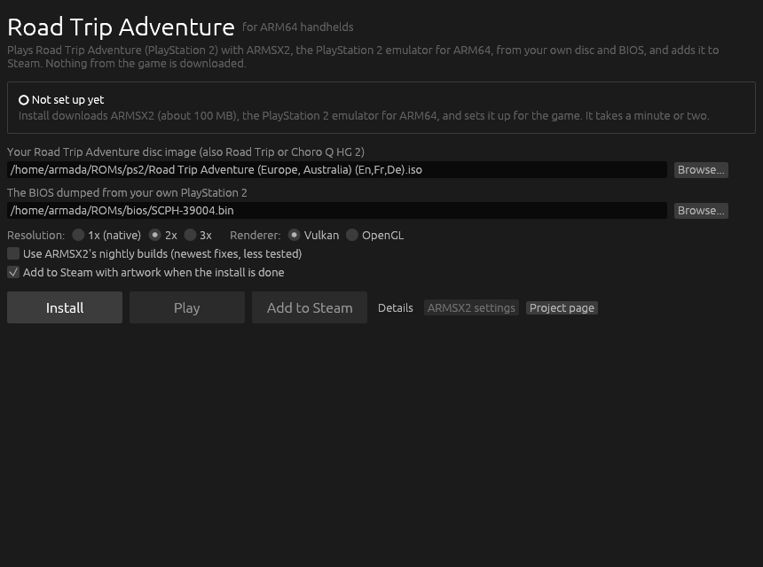
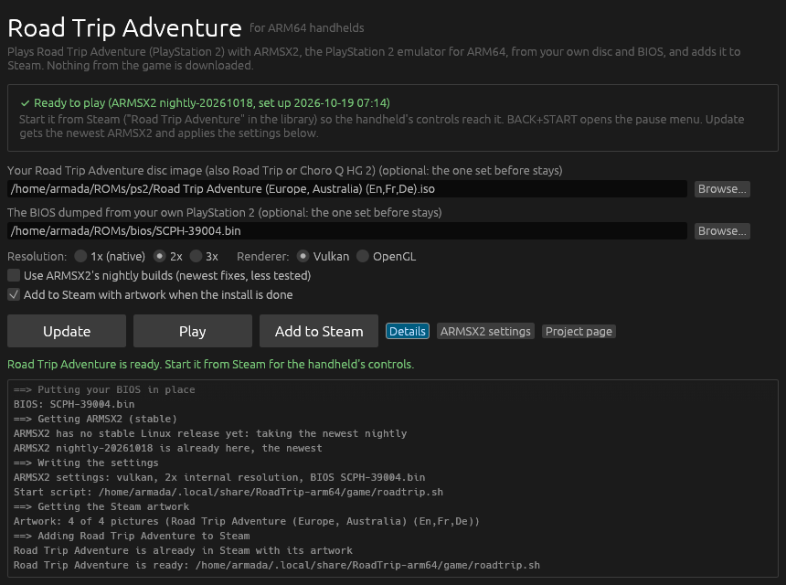

# road-trip-arm64

Road Trip Adventure (PlayStation 2, 2002; Road Trip in North America, Choro Q
HG 2 in Japan) on ARM64 Linux handhelds such as the Retroid Pocket 6 with
ArmadaOS, through [ARMSX2](https://github.com/ARMSX2/ARMSX2), the
PlayStation 2 emulator for ARM64 derived from PCSX2. A launcher downloads
ARMSX2's own Linux arm64 build, sets it up for the game from your disc and
BIOS, and adds the game to Steam with its artwork, like the launchers of
[pinyon-shift-arm64](https://github.com/Ken5998/pinyon-shift-arm64) and
[fifa-street-arm64](https://github.com/Ken5998/fifa-street-arm64).

**Why an emulator and not a native port:** unlike those games, Road Trip
Adventure has no public decompilation or recompilation, and the generic PS2
recompiler ([PS2Recomp](https://github.com/ran-j/PS2Recomp)) is still
experimental, with the graphics (GS) and vector units (VU) stubbed. ARMSX2 runs
natively on ARM64 with JIT recompilers, and this is a light game: PCSX2's
database rates the European release (SLES-51356) as perfect, needing only a
sprite fix that ARMSX2 applies by itself. At the PS2's own resolution the
handheld has little to do, so a port would save little power.

**Status:** CI installs ARMSX2's current release on an ARM64 runner in Fedora
44 and checks that it finds all its libraries; it has not yet been played on a
handheld. ARMSX2's Linux build is young (a first test release in July 2026,
nightly builds since).

This repository holds scripts and the launcher only. It never contains the
game, a BIOS or ARMSX2 itself, and none may be published here.

## What you need

- Your own Road Trip Adventure disc image: `.iso`, `.chd`, `.cso`, `.zso`,
  `.gz` or `.cue` (Road Trip and Choro Q HG 2 work the same).
- The BIOS dumped from your own PlayStation 2, a 4 MB `.bin` file such as
  `SCPH-39004.bin`.
- `git`, `python3` and `curl` on the handheld, as ArmadaOS has, and about
  1 GB free.

## With the launcher



1. In Desktop Mode, download `RoadTrip-Launcher-linux-arm64.tar.gz` from
   [Releases](https://github.com/Ken5998/road-trip-arm64/releases/latest)
   and unpack it.
2. Start `RoadTrip/roadtrip-launcher`. It looks for disc images and BIOS
   files in your home folder, Downloads, ROM, emulation and BIOS folders and
   SD cards; **Browse...** picks others.
3. Choose the resolution and the renderer, then press **Install**. It fetches
   this repository's scripts, downloads ARMSX2 and runs
   `scripts/install.sh` (below); **Details** shows its output. When it is
   done, **Road Trip Adventure** is in the Steam library.



**Update** gets the newest ARMSX2 and applies changed settings. **ARMSX2
settings** opens ARMSX2's own window with the game's settings, for anything
the launcher does not set. The launcher's log is
`~/.local/share/RoadTrip-arm64/launcher.log`.

## From a terminal

In Desktop Mode:

```bash
git clone https://github.com/Ken5998/road-trip-arm64
road-trip-arm64/scripts/install.sh "/path/to/Road Trip Adventure.iso" /path/to/SCPH-39004.bin
```

Everything goes to `~/.local/share/RoadTrip-arm64`, the folder the launcher
uses too. Run it again with `-` for the disc and the BIOS to update ARMSX2 and
rewrite the settings while keeping both:

```bash
RT_SCALE=1 road-trip-arm64/scripts/install.sh - -
```

| Variable | Default | What it does |
| --- | --- | --- |
| `RT_SCALE` | `2` | Internal resolution, 1 to 8 (1 is the PS2's own and draws the least power). |
| `RT_RENDERER` | `vulkan` | `vulkan` or `opengl`. |
| `RT_CHANNEL` | `stable` | `stable` takes ARMSX2's newest stable release with a Linux arm64 build, or its newest nightly while there is none; `nightly` always takes the newest nightly. |
| `RT_ADD_TO_STEAM` | `0` | `1` adds the game to Steam at the end (`scripts/add-to-steam.sh` does it later). |

The game starts with `~/.local/share/RoadTrip-arm64/game/roadtrip.sh`;
`roadtrip.sh --settings` opens ARMSX2's window instead.

## Playing

Start the game from Steam: on ArmadaOS the handheld's controls reach a game
only when Steam launches it. Steam adds it as a non-Steam game (native, no
Proton) with the box art, title screen and a screenshot from
[libretro-thumbnails](https://github.com/libretro-thumbnails/Sony_-_PlayStation_2),
downloaded at install time. Steam is closed for a moment and started again,
since it would otherwise overwrite the new entry.

- **Controls:** player 1 is the first controller, which under Steam is the
  handheld's own pad, laid out as a DualShock 2 by position: the bottom face
  button is Cross, the right one Circle, the left one Square and the top one
  Triangle.
- **Pause menu:** BACK+START (Escape on a keyboard). Quit the game from
  there; ARMSX2 closes with it.
- **Settings the install writes:** the BIOS, the renderer and resolution, full
  screen without ARMSX2's main window, no update check or exit question.
  Everything else stays as ARMSX2 has it, including what you change in its
  window.
- **Power:** 1x resolution and Steam's frame limiter in the Quick Access Menu
  draw the least. The European release runs at 50 Hz.
- **Overlay flicker:** if MangoHud or the Steam overlay flicker over the game
  on the Retroid Pocket 6, the launcher's **Turn it off** button adds the
  kernel option `msm.enable_preemption=0` (undo with
  `sudo rpm-ostree kargs --delete=msm.enable_preemption=0`).

ARMSX2 keeps its settings, memory cards and save states in
`~/.local/share/RoadTrip-arm64/ARMSX2`, apart from any other ARMSX2 you use.

## What is here

| Path | What it does |
| --- | --- |
| `launcher/` | The launcher window (Rust, egui): runs `scripts/install.sh` from a fresh copy of this repository, then plays the game or adds it to Steam. |
| `scripts/install.sh DISC\|- BIOS\|- [DIR]` | Downloads and unpacks ARMSX2, puts the BIOS in place, writes the settings and `game/roadtrip.sh`, and downloads the artwork. |
| `scripts/pick-release.py` | Picks the ARMSX2 release and its AppImage for the page size of the kernel (4K, or 16K on Apple Silicon). |
| `scripts/configure.py` | Writes the settings into ARMSX2's `PCSX2.ini`, keeping the rest. |
| `scripts/add-to-steam.sh [DIR]` | Adds the game to Steam with its artwork (`scripts/add-to-steam.py` writes the entry). |
| `scripts/package-launcher.sh [OUT]` | Builds the launcher and packs it for a release. |
| `tests/` | The install with a stand-in ARMSX2, and the Steam entry against a made-up Steam folder. |
| `.github/workflows/ci.yml` | The tests and a real install on an ARM64 runner in Fedora 44 (the base of ArmadaOS); the launcher on ARM64, with its window opened on a virtual screen. |
| `.github/workflows/release.yml` | Publishes the launcher for ARM64 Linux as a release. |

## License

MIT (see `LICENSE` and `NOTICE`). ARMSX2 is GPL-3.0 and is downloaded from
its own releases; the game and the BIOS are yours.
